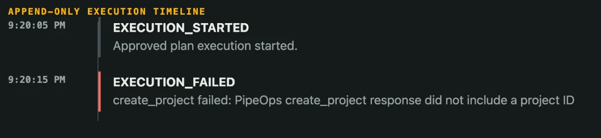
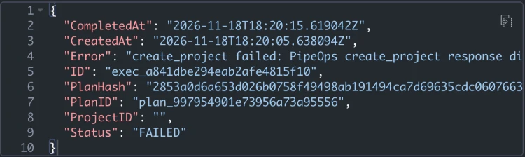
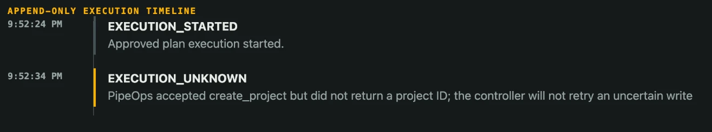
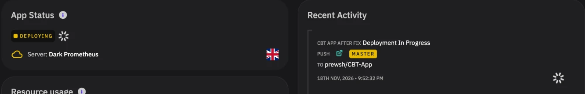
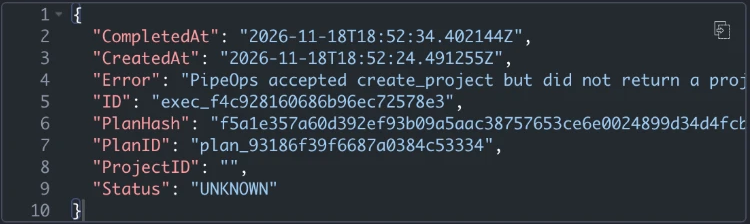
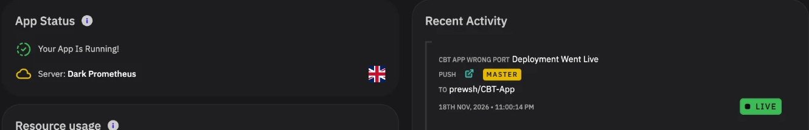
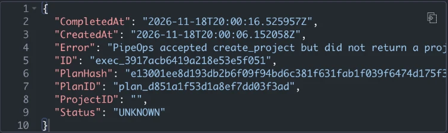
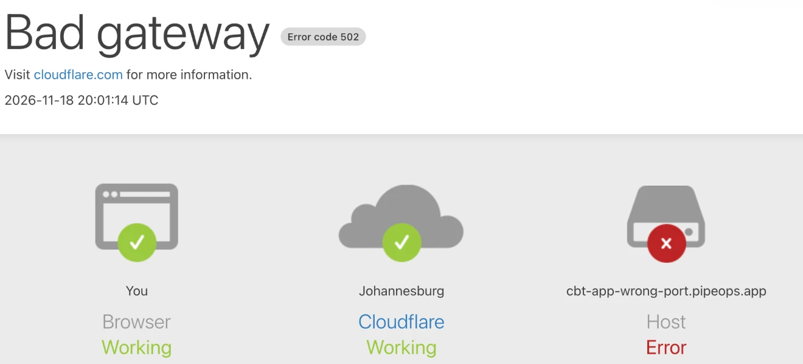
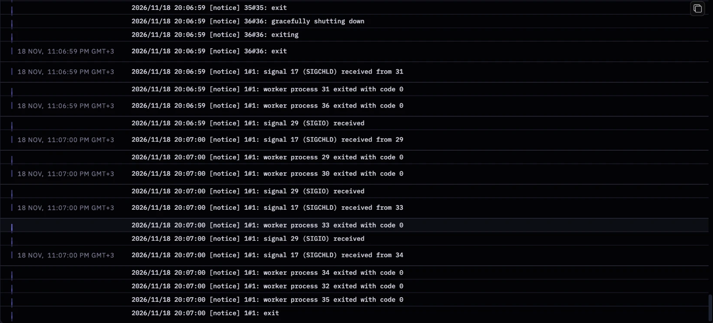

# Live PipeOps runs — 2026-11-18

- **Source:** controller results in MCP Inspector, the controller's local timeline page, the PipeOps console, and a browser request to the deployed URL. All captured by the operator on 18 November 2026.
- **Times:** the console and timeline show local time (GMT+3). UTC is given in brackets where the source shows it.
- **Client and protocol:** MCP Inspector was the client. Both hops (Inspector → controller and controller → PipeOps MCP) negotiated MCP protocol version `2025-11-25`.
- **Application:** `prewsh/CBT-App`, branch `master`, an Nginx image that listens on port `80`.
- **Sanitization:** no credentials were captured. Workspace, environment and server IDs are omitted. Execution IDs, plan IDs and plan hashes are local controller values and are shown as captured.

These runs repeat the 2026-08-28 experiments ([live-pipeops-2026-08-28.md](live-pipeops-2026-08-28.md)) once with the code from before the uncertainty fix and twice with the fixed code.

| Run | Controller commit | Project | Port | PipeOps said | Controller said | Reality |
| --- | --- | --- | --- | --- | --- | --- |
| A1 | `546d231` (before the fix) | `cbt-app-before-fix` | 80 | Deployment Went Live | `FAILED` | App served the Quick Quiz page |
| A2 | `7d7c340` (includes fix `8f8319b`) | `cbt-app-after-fix` | 80 | Deploying | `UNKNOWN` | The deployment had not finished when the controller answered |
| B | `7d7c340` (includes fix `8f8319b`) | `cbt-app-wrong-port` | 3000 | Deployment Went Live | `UNKNOWN` | URL returned 502 Bad Gateway |

In all three runs the controller stopped after `create_project` because it found no project ID in the response. It did not call `deploy_project` and did not observe the deployment. **Its verdicts come from the missing ID, not from checking the app.**

## Run A1 — before the fix

- Controller execution `exec_a841dbe294eab2afe4815f10` started 9:20:05 PM (18:20:05 UTC) and ended 9:20:15 PM (18:20:15 UTC).
- Controller result: `FAILED` with `create_project failed: PipeOps create_project response did not include a project ID`. `ProjectID` is empty.
- PipeOps console: Cbt-App-Before-Fix, "Your App Is Running", "Deployment Went Live" at 9:20:14 PM.
- The public URL served the Quick Quiz page.

So PipeOps reported the app live one second before the controller reported the execution as failed.

## Run A2 — after the fix, same plan inputs

- Controller execution `exec_f4c928160686b96ec72578e3` started 9:52:24 PM (18:52:24 UTC) and ended 9:52:34 PM (18:52:34 UTC).
- Controller result: `UNKNOWN` with `PipeOps accepted create_project but did not return a project ID; the controller will not retry an uncertain write`. `ProjectID` is empty.
- PipeOps console at that moment: Cbt-App-After-Fix, App Status `DEPLOYING`, deployment in progress since 9:52:32 PM.
- The controller made no further write after `UNKNOWN`.

When the controller had to answer, the deployment had not finished, so no one could yet say how it would end. Reporting `FAILED` would have invited a retry and a second project; reporting `SUCCEEDED` would have claimed something nobody had seen.

## Run B — wrong port, after the fix

- The plan configured port `3000`. The image listens on port `80`.
- Controller execution `exec_3917acb6419a218e53e5f051` started 11:00:06 PM (20:00:06 UTC) and ended 11:00:16 PM (20:00:16 UTC).
- Controller result: `UNKNOWN`, with the same missing-project-ID message as A2.
- PipeOps console: Cbt-App-Wrong-Port, "Your App Is Running", "Deployment Went Live" at 11:00:14 PM.
- Browser request to `cbt-app-wrong-port.pipeops.app` at 20:01:14 UTC: Cloudflare `502 Bad Gateway`, host error. The operator checked again later the same night and still got a 502.
- Nginx runtime logs at 20:06:59–20:07:00 UTC show a graceful shutdown: workers exiting with code 0, then the master process exiting. This is the container being stopped, not the app crashing.

This differs from the 2026-08-28 wrong-port run, where the PipeOps pipeline itself reached `FAILED` after a readiness-probe connection refusal. On 2026-11-18 the console reported the deployment live while the URL returned 502.

The controller did not detect the 502. Its `UNKNOWN` came from the missing project ID. The 502 was found by the operator.

## What these runs do and don't show

- The uncertainty fix behaves as intended: an accepted `create_project` without a project ID is now `UNKNOWN`, and the controller does not retry it.
- Platform status alone was not reliable evidence of a working app in Run B.
- The controller has still not observed a live deployment itself, because it has never received a project ID from a live `create_project` call. It has never reported `HEALTHY` on a live run.
- The lost-response experiment has still not been run live.
